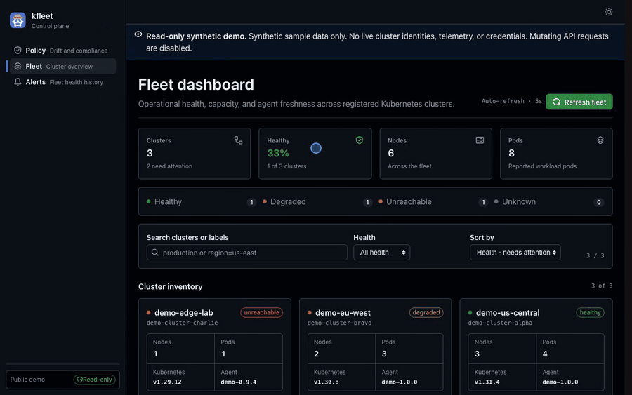
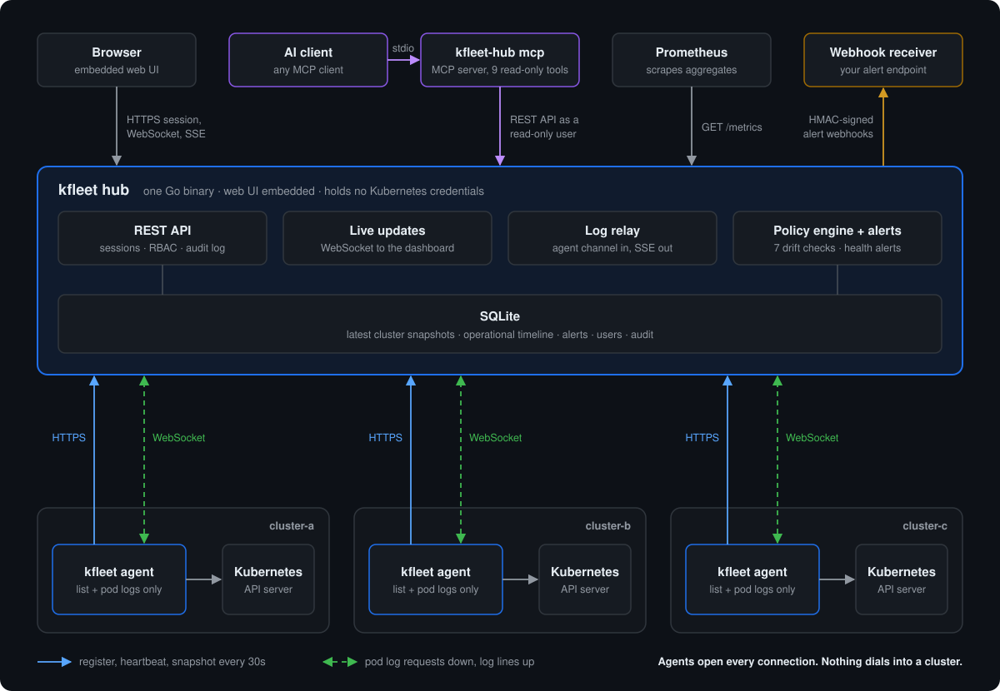

<p align="center">
  <picture>
    <source media="(prefers-color-scheme: dark)" srcset="docs/brand/png/kfleet-logo-dark-128.png">
    
  </picture>
</p>

# kfleet

> Read-only multi-cluster Kubernetes visibility and MCP diagnostics in a single 14 MB Go + SQLite binary — without handing anyone (or any AI client) a kubeconfig.

[](https://github.com/1solomonwakhungu/kfleet/actions/workflows/ci.yml)
[](https://github.com/1solomonwakhungu/kfleet/releases)
[](LICENSE)
[](https://goreportcard.com/report/github.com/1solomonwakhungu/kfleet)
[](https://github.com/1solomonwakhungu/kfleet/pkgs/container/kfleet%2Fhub)

kfleet is a lightweight, read-only control plane for a fleet of Kubernetes clusters. One small outbound-only agent per cluster reports state to a single Go hub. The hub serves an embedded web UI, a REST API, live pod log streaming, cross-cluster drift checks, signed health alerts, and a read-only Model Context Protocol (MCP) server — all backed by one SQLite file.

<p align="center">
  <a href="https://kfleet.sullylab.de">
    
  </a>
</p>

<p align="center">
  <a href="https://kfleet.sullylab.de"><strong>Try the live demo</strong></a> (synthetic data, read-only)
  ·
  <a href="#try-it-in-30-seconds">Run locally in 30s</a>
  ·
  <a href="#install-with-helm">Install with Helm</a>
  ·
  <a href="#use-it-from-an-ai-client-mcp">MCP setup</a>
  ·
  <a href="docs/README.md">Docs</a>
</p>

The recording shows the hub running in [demo mode](docs/public-demo.md) with three synthetic clusters (`demo-us-central`, `demo-eu-west`, `demo-edge-lab`). Nothing in it comes from a real environment.

## Contents

- [Why kfleet](#why-kfleet)
- [Architecture](#architecture)
- [Try it in 30 seconds](#try-it-in-30-seconds)
- [Install with Helm](#install-with-helm)
- [Use it from an AI client (MCP)](#use-it-from-an-ai-client-mcp)
- [What you get](#what-you-get)
- [Development](#development)
- [Documentation](#documentation)

## Why kfleet

Rancher, Open Cluster Management (OCM), Lens, Headlamp, `k9s`, and kubeconfig-based Kubernetes MCP servers are great tools that do more than kfleet does. kfleet is built for one specific job: **let engineers and AI clients see across a fleet of clusters without running a heavy management platform, exposing private cluster APIs, or widening write/secret access.**

### 1. The hub is one 14 MB process

The hub is a single static Go binary (`CGO_ENABLED=0`) with the React UI embedded and SQLite (WAL mode) as its only store. In demo mode with three clusters loaded it idles at ~20 MB of memory. No management cluster, no CRDs, no cert-manager, and no operators — run it as a Kubernetes Deployment, a container, or a plain binary on a VM.

### 2. Zero kubeconfigs centrally — 3-rule read-only agent RBAC

The hub holds no kubeconfigs, service account tokens, or cluster certificates. Each agent initiates outbound HTTPS and WebSocket connections to the hub, so cluster API servers never need to be reachable from the hub or from anyone's laptop.

The agent's entire `ClusterRole` (`charts/kfleet-agent/templates/clusterrole.yaml`) is three rules:

```yaml
rules:
  - apiGroups: [""]
    resources: ["pods", "services", "nodes", "events", "namespaces"]
    verbs: ["list"]
  - apiGroups: ["apps"]
    resources: ["deployments"]
    verbs: ["list"]
  - apiGroups: [""]
    resources: ["pods/log"]
    verbs: ["get"]
```

It cannot read `Secrets` or `ConfigMaps`, and it has no write verbs. If the hub is compromised, an attacker gets cluster inventory and pod logs — never a foothold to mutate workloads or exfiltrate secrets.

### 3. Built-in read-only MCP without kubeconfig sprawl

Most Kubernetes MCP servers require mounting multi-context kubeconfigs onto a developer's laptop or granting an in-cluster LLM direct API-server credentials. kfleet ships a read-only MCP server directly inside both the `kfleet` CLI (`kfleet mcp`) and the hub binary (`hub mcp`). It exposes **9 read-only tools**, authenticates to the hub as a normal `read_only` user (or anonymously against a demo-mode hub), and works across every connected cluster — even private or edge clusters behind NAT — with any MCP client (Claude Desktop, Claude Code, Cursor, etc.).

### 4. It remembers when a cluster goes dark

Live-pull tools like Lens, Headlamp, and `k9s` show nothing when a cluster API server is unreachable. kfleet retains each cluster's last snapshot plus an append-only 90-day operational timeline in SQLite, so you can still inspect the last known state, see when heartbeats stopped, review what changed beforehand, and track 7 cross-cluster drift checks and HMAC-signed health alerts.

### At a glance

| | kfleet | Rancher | Lens | Headlamp | OCM | Kubeconfig MCP servers |
| --- | --- | --- | --- | --- | --- | --- |
| Central footprint | 1 Go binary + SQLite | Dedicated K8s cluster | None | None, or in-cluster app | Operator + controllers | Local/in-cluster process |
| In-cluster footprint | 1 agent (3 read rules) | `cluster-admin` agent | None | None | Klusterlet agents | None |
| Central/laptop kubeconfigs | **None** | Central proxy | Per-user kubeconfig | Per-user kubeconfig | Agents pull work | Required on client/host |
| Can mutate clusters | **No** | Yes | Yes | Yes | Yes | Depends on RBAC |
| Offline cluster history | Last snapshot + 90d timeline | Last status | None | None | Last status | None |
| AI / MCP interface | Read-only MCP built in (9 tools) | Liz + MCP (Prime) | Prism + MCP (proprietary) | AI Assistant plugin | Community MCP servers | MCP only (no UI/alerts/drift) |
| License | Apache 2.0 | Apache 2.0 | Proprietary / free tier | Apache 2.0 | Apache 2.0 | Varies |

*Competitor details checked November 2026. If a cell is out of date, please open an issue.*

### When to pick something else

- **Cluster provisioning, GitOps, or workload deployment:** Use Rancher, ArgoCD, Flux, or OCM. kfleet never writes to clusters.
- **Interactive debugging (`exec`, port-forward, editing YAML):** Use `k9s`, Lens/Freelens, Headlamp, or `kubectl`.
- **Multi-replica HA control plane:** The hub is a single replica on SQLite. A hub outage interrupts visibility (never your workloads), but it is not active-active HA.
- **Broad CRD / resource inventory:** The agent currently collects `pods`, `deployments`, `services`, `nodes`, `namespaces`, `events`, and `pods/log`.

## Architecture

<p align="center">
  
</p>

- **Hub (`cmd/hub`):** The single entry point for humans, Prometheus (`/metrics`), and AI clients (`kfleet mcp` or `hub mcp`). Serves the embedded React UI, REST API, live dashboard WebSocket, session auth (`admin`, `operator`, `read_only`), audit log, policy/drift engine, and SQLite store.
- **Agent (`cmd/agent`):** One Deployment per cluster (`50m` CPU / `64Mi` RAM default requests). Registers using a shared registration token, waits for operator/admin approval, then sends 15s heartbeats and 30s normalized snapshots. Marks a cluster stale after 3 missed intervals.
- **Log relay:** Each approved agent holds an outbound WebSocket to the hub. When a user or MCP client requests pod logs, the hub forwards the request down that socket and streams lines back over Server-Sent Events (SSE). See [Pod log streaming](docs/pod-logs.md).
- **Alerts out:** Evaluates fleet health transitions (`degraded`, `unreachable`) and delivers HMAC-SHA256-signed webhooks with durable retries and dead-letter tracking. See [Fleet health alerts](docs/alerts.md).

## Try it in 30 seconds

### Option 1: Hosted live demo (0 seconds)

Open **[https://kfleet.sullylab.de](https://kfleet.sullylab.de)** — no login, synthetic data, all mutations blocked with HTTP 405.

### Option 2: Local demo with Docker (10 seconds, no Kubernetes required)

Runs the embedded UI and API against an in-memory SQLite database seeded with three synthetic clusters:

```bash
docker run --rm -p 8080:8080 \
  -e KFLEET_DEMO_MODE=true \
  ghcr.io/1solomonwakhungu/kfleet/hub:v0.3.0
```

Open <http://localhost:8080>.

<details>
<summary>Or run demo mode from source (requires Go 1.26+ and Node.js 22)</summary>

```bash
git clone https://github.com/1solomonwakhungu/kfleet.git
cd kfleet
make web-build
KFLEET_DEMO_MODE=true go run ./cmd/hub
```

</details>

### Option 3: Three real local `kind` clusters (Homebrew)

The Homebrew cask installs the `kfleet` CLI (local quickstart + read-only MCP server) along with `kind`, `kubectl`, and `helm` (requires Docker running):

```bash
brew install --cask 1solomonwakhungu/tap/kfleet
kfleet quickstart
```

This creates three `kind` clusters (`kfleet-1..3`), installs the released hub and agents via OCI Helm charts, starts a port-forward, and prints your local URL and generated admin credentials.

```bash
kfleet quickstart --clusters 2 --port 9090   # customize cluster count or port
kfleet status                                # check hub readiness
kfleet open                                  # open the UI in your browser
kfleet mcp                                   # run the read-only stdio MCP server
kfleet cleanup                               # tear down all clusters and port-forward
```

From a source checkout, `./hack/quickstart.sh` builds images from your working tree and runs the same local stack.

## Install with Helm

### 1. Install the hub (once)

```bash
export KFLEET_REGISTRATION_TOKEN="$(openssl rand -hex 32)"
export KFLEET_ADMIN_PASSWORD="$(openssl rand -base64 24)"

helm upgrade --install kfleet-hub \
  oci://ghcr.io/1solomonwakhungu/charts/kfleet-hub \
  --version 0.3.0 \
  --namespace kfleet-system \
  --create-namespace \
  --set registration.token="$KFLEET_REGISTRATION_TOKEN" \
  --set-string auth.bootstrapAdmin.username=admin \
  --set-string auth.bootstrapAdmin.email=admin@example.com \
  --set-string auth.bootstrapAdmin.password="$KFLEET_ADMIN_PASSWORD" \
  --set persistence.enabled=true \
  --set persistence.size=1Gi
```

Expose the hub via Ingress, `LoadBalancer`, or `kubectl port-forward`.

### 2. Install the agent in each cluster you want to observe

```bash
helm upgrade --install kfleet-agent \
  oci://ghcr.io/1solomonwakhungu/charts/kfleet-agent \
  --version 0.3.0 \
  --kube-context my-cluster \
  --namespace kfleet-system \
  --create-namespace \
  --set hub.url=https://kfleet.example.com \
  --set hub.token="$KFLEET_REGISTRATION_TOKEN" \
  --set cluster.name=my-cluster
```

Sign in to the hub UI as the bootstrap admin and approve the pending agent on the **Agents** page (operators can approve too). The cluster appears on the dashboard on its next report.

### Production notes

- `hub.url`, `hub.token`, and `cluster.name` are required; the agent fails fast naming any missing variable.
- For GitOps / External Secrets, pass existing Kubernetes Secrets with `registration.existingSecret` + `auth.existingSecret` (hub) and `hub.existingSecret` (agent).
- For private or internal CAs, pass a PEM bundle via `hub.caBundle` (agent).
- Default resource requests: **100m CPU / 128Mi RAM** (hub) and **50m CPU / 64Mi RAM** (agent).
- See the [operations runbook](docs/operations.md) for all environment variables, probes, backups, and upgrades, and [authentication & authorization](docs/authentication.md) for roles, sessions, audit logs, and token rotation.

## Use it from an AI client (MCP)

Both the `kfleet` CLI (`kfleet mcp`, included with the Homebrew cask) and the `hub` binary (`hub mcp`, from [GitHub Releases](https://github.com/1solomonwakhungu/kfleet/releases) or Docker `ghcr.io/1solomonwakhungu/kfleet/hub:v0.3.0 mcp`) run the read-only stdio MCP server against a kfleet hub's REST API.

### Try MCP against the live demo (no credentials)

Point your MCP client at the hosted read-only demo (`https://kfleet.sullylab.de`) with no username or password required:

**Claude Desktop / Cursor (`mcpServers` JSON):**

```json
{
  "mcpServers": {
    "kfleet-demo": {
      "command": "kfleet",
      "args": ["mcp"],
      "env": {
        "KFLEET_HUB_URL": "https://kfleet.sullylab.de"
      }
    }
  }
}
```

**Claude Code CLI:**

```bash
claude mcp add kfleet-demo \
  -e KFLEET_HUB_URL=https://kfleet.sullylab.de \
  -- kfleet mcp
```

Using the `hub` binary from GitHub Releases instead of Homebrew? Replace `kfleet mcp` with `/usr/local/bin/hub mcp` (or `docker run --rm -i -e KFLEET_HUB_URL=https://kfleet.sullylab.de ghcr.io/1solomonwakhungu/kfleet/hub:v0.3.0 mcp`).

### Connect to your own hub

1. Install `kfleet` via Homebrew (`brew install --cask 1solomonwakhungu/tap/kfleet`), download `kfleet` or `hub` for your OS/arch from [GitHub Releases](https://github.com/1solomonwakhungu/kfleet/releases) (e.g. `hub_0.3.0_darwin_arm64.tar.gz`), or run via Docker (`ghcr.io/1solomonwakhungu/kfleet/hub:v0.3.0`).
2. Create a dedicated `read_only` user in the hub at `/admin/users`.
3. Add kfleet to your MCP client:

**Claude Desktop / Cursor (`mcpServers` JSON, Homebrew `kfleet`):**

```json
{
  "mcpServers": {
    "kfleet": {
      "command": "kfleet",
      "args": ["mcp"],
      "env": {
        "KFLEET_HUB_URL": "http://localhost:8080",
        "KFLEET_HUB_USERNAME": "mcp-reader",
        "KFLEET_HUB_PASSWORD": "replace-with-read-only-password"
      }
    }
  }
}
```

<details>
<summary>Use the <code>hub</code> binary from GitHub Releases</summary>

```json
{
  "mcpServers": {
    "kfleet": {
      "command": "/usr/local/bin/hub",
      "args": ["mcp"],
      "env": {
        "KFLEET_HUB_URL": "http://localhost:8080",
        "KFLEET_HUB_USERNAME": "mcp-reader",
        "KFLEET_HUB_PASSWORD": "replace-with-read-only-password"
      }
    }
  }
}
```

</details>

<details>
<summary>Run MCP via Docker (no local binary download needed)</summary>

```json
{
  "mcpServers": {
    "kfleet": {
      "command": "docker",
      "args": [
        "run", "--rm", "-i",
        "-e", "KFLEET_HUB_URL",
        "-e", "KFLEET_HUB_USERNAME",
        "-e", "KFLEET_HUB_PASSWORD",
        "ghcr.io/1solomonwakhungu/kfleet/hub:v0.3.0",
        "mcp"
      ],
      "env": {
        "KFLEET_HUB_URL": "https://kfleet.example.com",
        "KFLEET_HUB_USERNAME": "mcp-reader",
        "KFLEET_HUB_PASSWORD": "replace-with-read-only-password"
      }
    }
  }
}
```

</details>

<details>
<summary>Claude Code CLI</summary>

```bash
claude mcp add kfleet \
  -e KFLEET_HUB_URL=http://localhost:8080 \
  -e KFLEET_HUB_USERNAME=mcp-reader \
  -e KFLEET_HUB_PASSWORD=replace-with-read-only-password \
  -- kfleet mcp
```

(Or substitute `/usr/local/bin/hub mcp` if using the `hub` release archive.)

</details>

### Exposed MCP tools (all read-only)

| Tool | What it returns |
| --- | --- |
| `list_clusters` | Every cluster with health, Kubernetes version, node count, and pod count |
| `get_cluster_status` | Latest full status snapshot and node details for one cluster |
| `list_namespaces` | Namespaces in a cluster's latest snapshot |
| `get_pods` | Pods in a cluster, optionally filtered by namespace |
| `get_events` | Kubernetes events from the latest snapshot (filterable by namespace and `Normal`/`Warning`) |
| `get_recent_events` | Durable operational timeline (registrations, disconnects, reconnects, version changes, policy findings) |
| `find_crashloop_pods` | Pods in `CrashLoopBackOff` or with `>= 5` container restarts across one cluster or the whole fleet |
| `get_pod_logs` | Recent log lines for a pod container, including `previous: true` for crashlooping containers (default 100 lines, max 1000, capped at 256 KiB) |
| `diagnose_cluster` | Composite report combining cluster status, crashlooping pods, and Warning events |

**Prompts to try:**
- *"List my clusters and summarize anything that is not healthy."*
- *"Find crashlooping pods across the fleet and show me the previous container logs from the worst one."*
- *"Diagnose the production cluster and explain its recent Warning events."*
- *"Show recent disconnects, reconnects, and policy findings across the fleet."*

A standalone MCP binary entrypoint also lives at `./cmd/mcp`.

## What you get

| Feature | What it does | Details |
| --- | --- | --- |
| Fleet dashboard | Cluster health, Kubernetes version, node & pod counts, name/label search, and live WebSocket updates | |
| Cluster detail | Pods, deployments, services, events, node capacity, and labels with deep links to tabs, namespaces, and pods | |
| Pod logs | Live log streaming through the reverse agent channel with follow, tail, `previous`, and search | [pod-logs.md](docs/pod-logs.md) |
| Operational timeline | Append-only history of registrations, approvals, health changes, disconnects, reconnects, version changes, and policy findings (90-day retention, survives cluster deletion) | [api.md](docs/api.md#timeline-and-policy-findings) |
| Policy & drift | 7 built-in read-only checks (`kubernetes-version-consistency`, `required-cluster-labels`, `namespace-consistency`, `workload-configuration-consistency`, `workload-availability`, `pod-security-baseline`, `namespace-pod-security`) reporting `pass`, `fail`, `unknown`, or `stale` | [policy-drift.md](docs/policy-drift.md) |
| Health alerts | Alerts on `degraded` / `unreachable` transitions with acknowledgement and HMAC-SHA256-signed webhooks with durable retries | [alerts.md](docs/alerts.md) |
| Users & audit | `admin`, `operator`, and `read_only` roles with an append-only audit log of security-relevant actions | [authentication.md](docs/authentication.md) |
| Multi-tenancy | Agent and API traffic scoped by `X-Kfleet-Tenant-ID` / `KFLEET_TENANT_ID` | [policy-drift.md](docs/policy-drift.md#tenant-isolation) |
| Metrics & REST API | Prometheus `/metrics` (non-sensitive aggregate gauges) and full JSON REST API | [operations.md](docs/operations.md), [api.md](docs/api.md) |

## Development

Prerequisites: Go 1.26+, Node.js 22, Docker, `golangci-lint` (for `make lint`), and `kubectl` / Helm 3 / `kind` for end-to-end work.

```bash
make build       # Build embedded React UI + bin/kfleet, bin/hub, bin/agent
make web-build   # Build only the embedded React UI
make test        # Run Go tests with -race -cover
make lint        # Run golangci-lint
```

Run the hub locally with a disposable SQLite database:

```bash
KFLEET_DB_PATH=/tmp/kfleet.db \
KFLEET_SESSION_COOKIE_INSECURE=true \
KFLEET_BOOTSTRAP_ADMIN_USERNAME=admin \
KFLEET_BOOTSTRAP_ADMIN_EMAIL=admin@localhost \
KFLEET_BOOTSTRAP_ADMIN_PASSWORD='local-development-password' \
KFLEET_REGISTRATION_TOKEN=local-dev-registration-token \
go run ./cmd/hub
```

Run the MCP server against it:

```bash
KFLEET_HUB_URL=http://localhost:8080 \
KFLEET_HUB_USERNAME=admin \
KFLEET_HUB_PASSWORD='local-development-password' \
go run ./cmd/kfleet mcp
```

(Or `go run ./cmd/hub mcp`.)

| Path | Contents |
| --- | --- |
| `cmd/hub`, `cmd/agent`, `cmd/kfleet`, `cmd/mcp`, `cmd/webhook-receiver` | Entrypoints for hub, agent, quickstart & MCP CLI, standalone MCP server, and local alert webhook receiver |
| `internal/server`, `internal/store` | Hub HTTP handlers, SSE log relay, WebSocket hub, and SQLite store |
| `internal/agent` | Collector, registrar, heartbeat/snapshot reporter, and reverse log-channel client |
| `internal/policy`, `internal/alerts`, `internal/mcp` | 7 drift checks, durable alert delivery, and 9 MCP tools |
| `web/` | React UI built with `@primer/react` and `@primer/primitives` (embedded into the hub binary) |
| `charts/` | Helm charts for `kfleet-hub` and `kfleet-agent` |

To re-record `docs/assets/demo.gif`, see the header comments in [`hack/record-demo.mjs`](hack/record-demo.mjs).

## Documentation

- [Documentation index](docs/README.md)
- [REST API reference](docs/api.md)
- [Operations runbook](docs/operations.md)
- [Authentication and authorization](docs/authentication.md)
- [Fleet health alerts](docs/alerts.md)
- [Pod log streaming](docs/pod-logs.md)
- [Policy and configuration drift](docs/policy-drift.md)
- [Public read-only demo](docs/public-demo.md)

## Contributing

Contributions are welcome. See [CONTRIBUTING.md](CONTRIBUTING.md) for the PR flow, Conventional Commits, DCO sign-off, and local test/lint commands.

## License

kfleet is licensed under the [Apache License 2.0](LICENSE).
